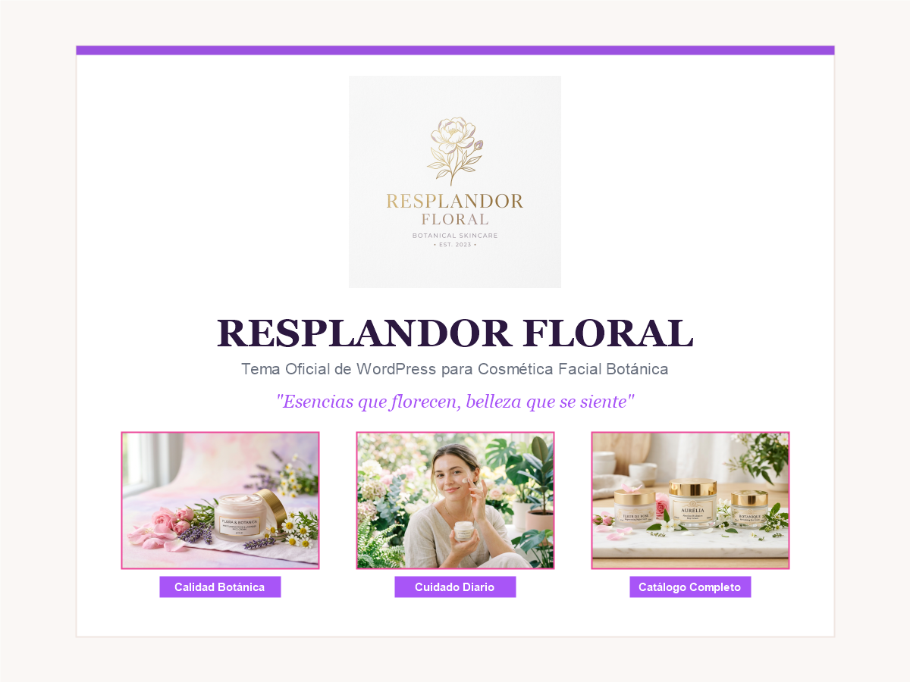

# 🌸 Resplandor Floral - WordPress Theme & Web Landing

[](https://wordpress.org)
[](https://php.net)
[](http://www.gnu.org/licenses/gpl-2.0.html)
[](https://www.docker.com/)

> **Resplandor Floral** es una plataforma y tema moderno para WordPress diseñado exclusivamente para marcas de cosmética natural, cremas faciales e hidratantes botánicas. Cuenta con una paleta elegante en tonos lavanda y violeta imperial, tipografía editorial, catálogo de productos con precios en pesos colombianos (COP), cotizador interactivo y personalización nativa.

---

## 📸 Vista Previa



---

## ✨ Características Principales

* **Fidelidad Visual y Diseño Exclusivo:**
  * Paleta de colores botánica: Púrpura imperial (`#9b51e0`, `#7a32bf`), acentos rosa (`#ec4899`, `#f472b6`) y fondo sedoso (`#faf7f5`).
  * Tipografías elegantes de Google Fonts: *DM Serif Display* (títulos) y *Questrial / Plus Jakarta Sans* (lectura).
  * Encabezado con efecto *glassmorphism* (desenfoque de cristal) y fijación superior (*sticky*).
  * Animación sutil de levitación en el isotipo botánico.

* **100% Administrable desde WordPress:**
  * **Personalizador Nativo (`Apariencia > Personalizar > 🌸 Opciones de Resplandor Floral`)**:
    * Modifica teléfono de contacto, número de WhatsApp para pedidos directos, correo y ubicación.
    * Enlaces a redes sociales (Facebook, Instagram, X/Twitter, WhatsApp).
  * **Soporte para Menús Dinámicos**: Menú de cabecera y pie de página con anclas de desplazamiento suave.
  * **Logotipo Personalizado**: Configurable desde *Identidad del sitio*.

* **Catálogo y Precios Integrados:**
  * Menú de precios editorial con puntos directores.
  * Colección de Cremas Faciales: Crema Reparadora ($35.000), Crema Rejuvenecedora ($40.000), Crema Premium ($48.000).
  * Línea por Tipo de Piel: Piel Mixta ($30.000), Piel Grasa ($32.000), Piel Seca ($35.000).

* **Conversión e Interactividad:**
  * Ventana modal interactiva para solicitud de pedidos y cotizaciones.
  * Procesamiento seguro vía AJAX con verificación de Nonce.
  * Botón directo para concretar pedidos por WhatsApp con mensaje predeterminado.

* **Arquitectura de Archivos Robusta:**
  * Soporte dual de assets (rutas relativas con fallback automático).
  * Listo para el editor de bloques Gutenberg (`theme.json`).
  * Plantillas completas: `front-page.php`, `header.php`, `footer.php`, `index.php`, `page.php`, `single.php`, `archive.php`, `comments.php`, `404.php`.

---

## 📁 Estructura del Repositorio

```text
├── resplandor-floral/           # Carpeta del Tema oficial de WordPress
│   ├── assets/
│   │   ├── images/              # Imágenes originales en alta resolución (logos, cremas, texturas)
│   │   └── js/                  # Scripts de interacción y modal AJAX
│   ├── template-parts/          # Fragmentos de plantilla (content.php, content-none.php)
│   ├── front-page.php           # Página de inicio completa
│   ├── header.php               # Cabecera y navegación
│   ├── footer.php               # Pie de página y modal de pedidos
│   ├── functions.php            # Registro de estilos, scripts y personalizador
│   ├── style.css                # Estilos CSS y cabecera del tema
│   ├── screenshot.png           # Captura de pantalla para el panel de temas (1200x900)
│   └── theme.json               # Configuración para el editor de bloques (Gutenberg)
│
├── index.html                   # Versión autónoma en HTML5/CSS3 para previsualización inmediata
├── docker-compose.yml           # Entorno local completo con WordPress 8.2 y MariaDB 10.11
├── resplandor-floral.zip        # Archivo ZIP autoinstalable para WordPress
└── README.md                    # Documentación del proyecto
```

---

## 🚀 Instalación

### Opción 1: Instalar en WordPress como Tema (.zip)
1. Descarga el archivo **`resplandor-floral.zip`**.
2. En tu panel de administración de WordPress, ve a **Apariencia > Temas**.
3. Haz clic en **Añadir nuevo tema** y luego en **Subir tema**.
4. Selecciona el archivo **`resplandor-floral.zip`**, haz clic en **Instalar ahora** y luego en **Activar**.

### Opción 2: Ejecutar localmente con Docker
Si tienes Docker Desktop instalado, puedes levantar todo el entorno local en 1 minuto:

```bash
# Clonar este repositorio
git clone https://github.com/tu-usuario/resplandor-floral.git
cd resplandor-floral

# Iniciar los contenedores
docker compose up -d
```

Abre tu navegador en:
* Sitio Web: `http://localhost:8080`
* Panel WordPress: `http://localhost:8080/wp-admin`
  * **Usuario:** `admin`
  * **Contraseña:** `password1234`

### Opción 3: Previsualización estática sin servidor
Simplemente abre el archivo **`index.html`** con cualquier navegador web (Chrome, Edge, Firefox, Safari).

---

## 🎨 Paleta de Colores

| Color | Hex | Uso |
| :--- | :--- | :--- |
| **Púrpura Principal** | `#9B51E0` | Botones, títulos destacados, bordes activos |
| **Púrpura Oscuro** | `#7A32BF` | Estados *hover*, cabeceras de sección |
| **Rosa Botánico** | `#EC4899` | Gradientes y acentos visuales |
| **Fondo Crema** | `#FAF7F5` | Fondo principal suave |
| **Texto Principal** | `#2B2B2B` | Párrafos y lectura de alta legibilidad |

---

## 📄 Licencia

Este proyecto está bajo la licencia **GNU General Public License v2 o posterior** (GPL-2.0-or-later).
